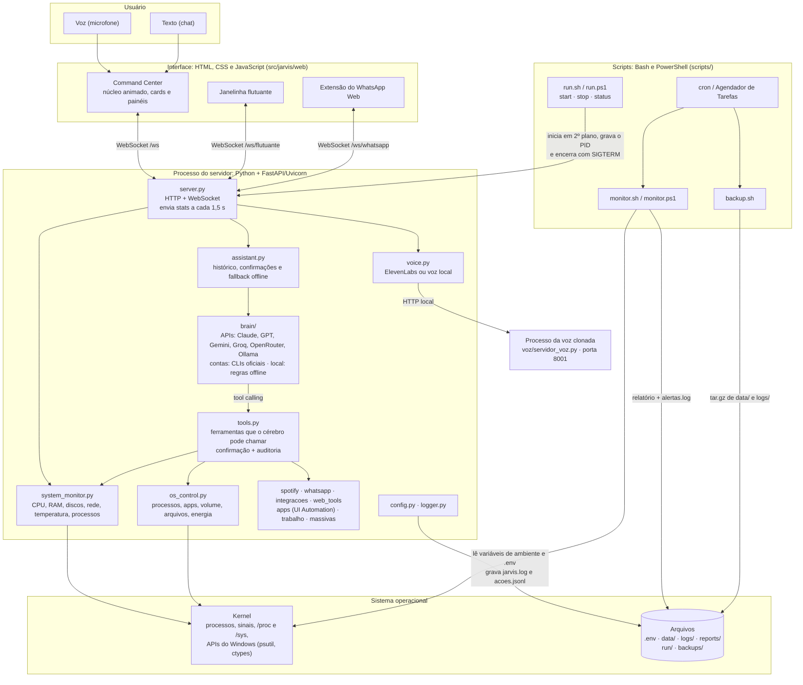
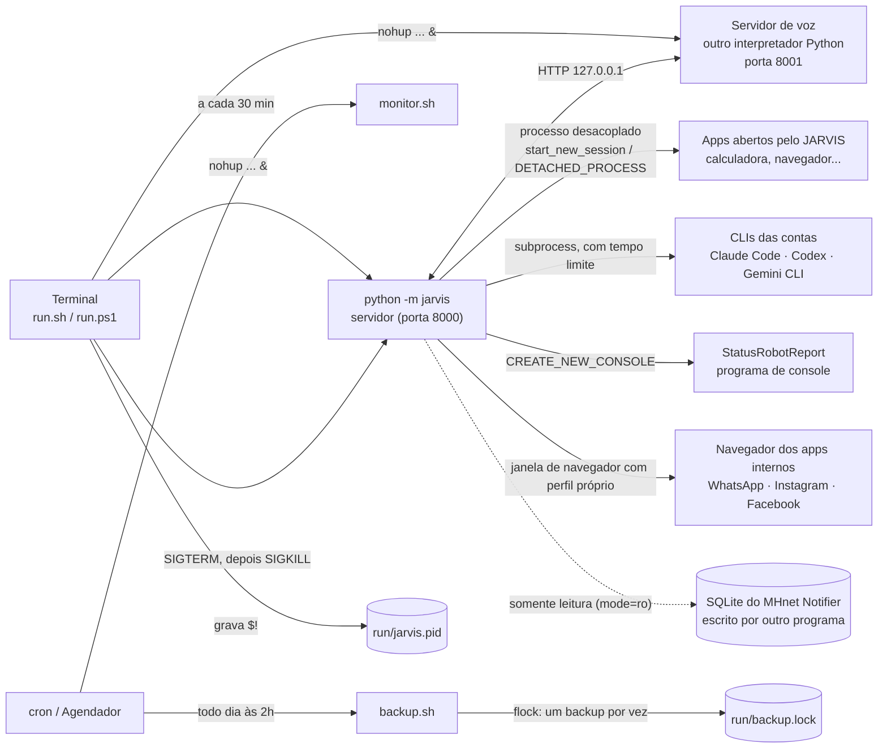
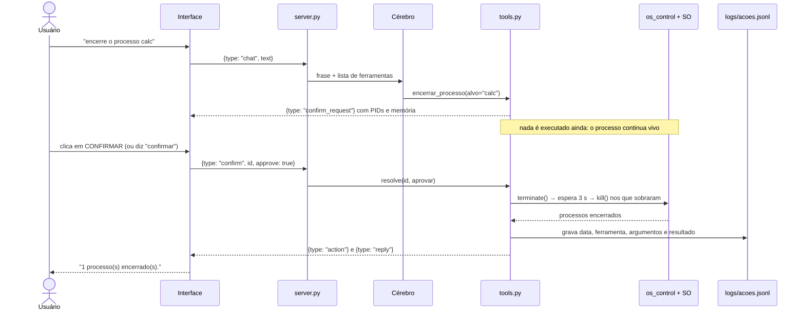

# Arquitetura do J.A.R.V.I.S.

Três visões do mesmo sistema:

1. **Camadas**: do usuário até o sistema operacional.
2. **Processos**: quem é processo de quem, e como eles se comunicam.
3. **Uma ação sensível do começo ao fim**: "encerre o processo calc".

Os diagramas estão em [Mermaid](https://mermaid.js.org/): o GitHub desenha a partir do texto, então dá para
editar e comparar no `git diff` como qualquer código.

## 1. Camadas

| Camada | O que faz | Arquivos |
|---|---|---|
| Interface | Mostra os dados e recebe comandos. Não acessa o SO: tudo passa pelo servidor | `src/jarvis/web/` |
| Servidor | Um único processo Python. Liga a interface ao cérebro e às ferramentas | `server.py`, `assistant.py` |
| Cérebro | Transforma a frase em **chamadas de ferramenta**. O cérebro *local* funciona sem internet | `brain/` |
| Ferramentas | Lista do que o JARVIS sabe fazer. Pede confirmação nas ações destrutivas e registra tudo em `logs/acoes.jsonl` | `tools.py` |
| Acesso ao SO | Lê os recursos (`psutil`, `/proc`, `/sys`) e age (cria e encerra processos, mexe em arquivos) | `system_monitor.py`, `os_control.py` |
| Scripts | Instalam, iniciam, param, monitoram e fazem backup **sem depender do Python** | `scripts/` |

## 2. Processos

- **Arquivo de PID:** o `run.sh` guarda em `run/jarvis.pid` o PID do servidor que acabou de criar (`$!`). O
  `status` e o `stop` usam esse número, e o `kill -0` só pergunta ao SO se o processo ainda existe.
- **Processos desacoplados:** os apps abertos pelo JARVIS ganham uma sessão própria. Se o JARVIS cair, eles
  continuam abertos.
- **Comunicação entre processos:** a voz clonada roda num processo separado, com outro Python e outras
  bibliotecas, e conversa com o servidor por HTTP local. Se esse processo cair, o servidor usa outra voz.
- **Arquivo compartilhado:** o banco SQLite de outro programa é aberto em **somente leitura**, para não
  disputar a escrita com quem é dono dele.
- **No Windows**, o `python.exe` da `.venv` é um lançador que cria o Python de verdade como **processo filho**
  e o coloca num *Job Object*. Por isso o `run.ps1` guarda o PID do lançador, e encerrar o lançador encerra
  os dois (ver [verificacao.md](verificacao.md), passos 1 e 7).

## 3. Uma ação sensível do começo ao fim

As mensagens trocadas pelo WebSocket estão descritas em [protocolo-websocket.md](protocolo-websocket.md).
